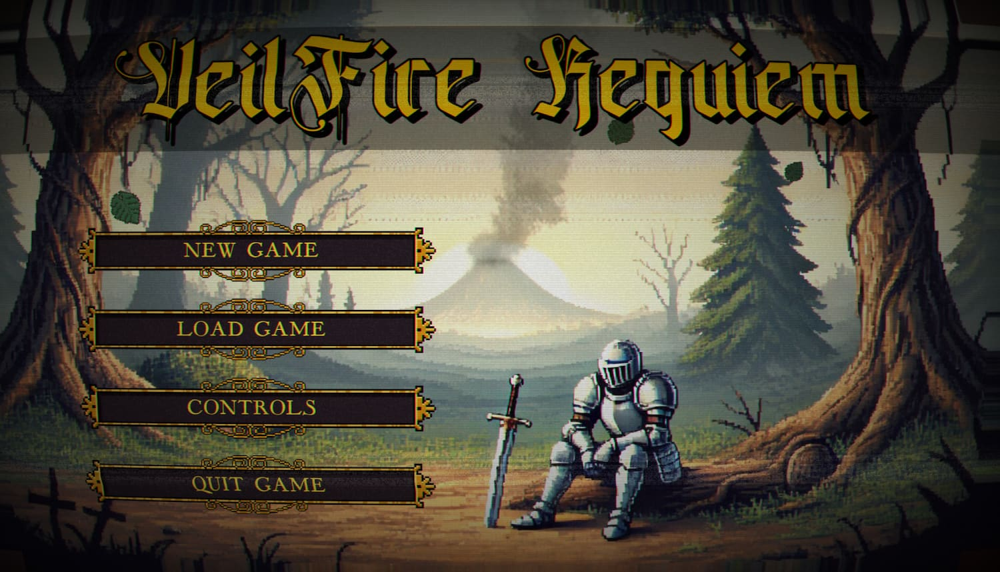
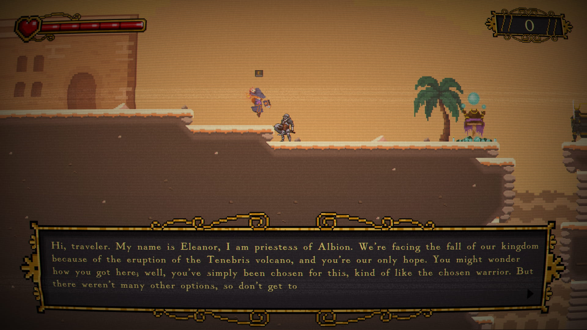
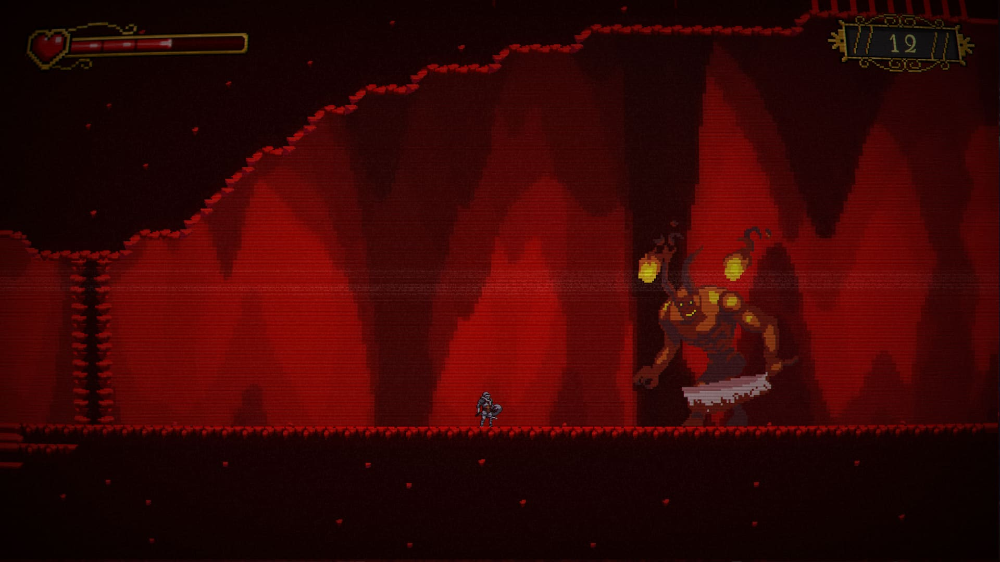

# VeilFire Requiem - (BETA)  

In a world on the brink of cataclysm, you play as a warrior destined to confront the eruption of the Tenebris Volcano, a threat many in your village dismiss as a “lie meant to control them.” Explore the Lands of Albion, face brutal enemies, and uncover the hidden truth behind despair and blind faith.

***Can you save Albion from the so-called volcano?***

---

  
  
  

---

##  Table of Contents 📜

- [📌 Current Version](#-current-version)
- [🚀 About the Game](#-about-the-game)
- [🛠️ Downloads](#️-downloads)
- [🔮 Planned for Future Updates](#-planned-for-future-updates)
- [🐛 Reporting Bugs & Feedback](#-reporting-bugs--feedback)

---

## 📌 Current Version: **BETA-1.1.0**  
### **VeilFire Requiem’s Enhanced update 1.1.0!**  

This is an **early BETA**, meaning:
- The game is **actively in development** — expect significant changes in future updates.  
- **Progress will NOT save between versions** (BETA-1.1.0 saves won’t work in later releases).  
- Current content is **unpolished**: placeholder art, bugs, and incomplete mechanics may appear.  

*(Want stability? Wait for the full release. Want to shape the game? Your feedback is gold!)*  

[Release BETA-1.1.0 notes](https://github.com/mesegr/VeilFire-Requiem/releases/tag/BETA-1.1.0)

---

### 🚀 **About the Game**  
**VeilFire Requiem** is a **2D action-adventure Metroidvania** with:  
- **Exploration-driven progression**: Unlock abilities and access new zones.  
- **Combat**: Dodge, slash, and brandish your sword.  
- **Atmospheric storytelling**: Discover a dying world’s secrets.  

⚠️ **This is a BETA**. Expect bugs, unfinished content, and placeholder assets.  

--- 

### 🛠️ **Downloads**  
1. Download the latest release for your OS (Windows/Linux).
- [Download_BETA-1.1.0._Linux](https://github.com/mesegr/VeilFire-Requiem/releases/download/BETA-1.1.0/VeilFire_Requiem_BETA-1.1.0_Linux.zip)
- [Download_BETA-1.1.0._Windows](https://github.com/mesegr/VeilFire-Requiem/releases/download/BETA-1.1.0/VeilFire_Requiem_BETA-1.1.0_Windows.zip)  
4. Extract the ZIP file.  
5. Run `VeilFire Requiem.exe` (or equivalent).  

### **Minimum Requirements**:  
- OS: Windows 10 / Linux (x86_64)  
- GPU: OpenGL 3.2+ compatible  
- RAM: 1GB  
- STORAGE: 450MB

---

### 🔮 **Planned for Future Updates**  
- **New zones**: Expanded lore and challenges.  
- **Sound design**: new music and SFX.  
- **World interactivity**: NPCs  and puzzles.  

---

## 🐛 **Reporting Bugs & Feedback**  
Found a bug? Have suggestions?  
- Open an **Issue** on this repo.  

Please include:  
- **Description**: What happened?  
- **Steps to reproduce**: How can we trigger it?  
- **Screenshots/Videos** (if possible).  
  
